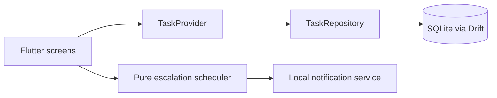

# ActMind Architecture

## Structure

- `domain/`: task values and enums.
- `data/`: Drift SQLite database, repository, and Provider state.
- `services/`: notifications and pure escalation scheduling.
- `ui/`: screens and widgets.

## Data model

Tasks contain title, notes, type, priority, deadline, completion state, completion time, and creation time. Subtasks are modeled in the Drift schema.

## Escalation engine

`EscalationScheduler` receives now, deadline, priority, quiet hours, lead time, and a rolling window. It returns notification times and tones. High priority tasks cross to urgent states earlier. Quiet-hour nudges are moved to the end of the quiet window.
